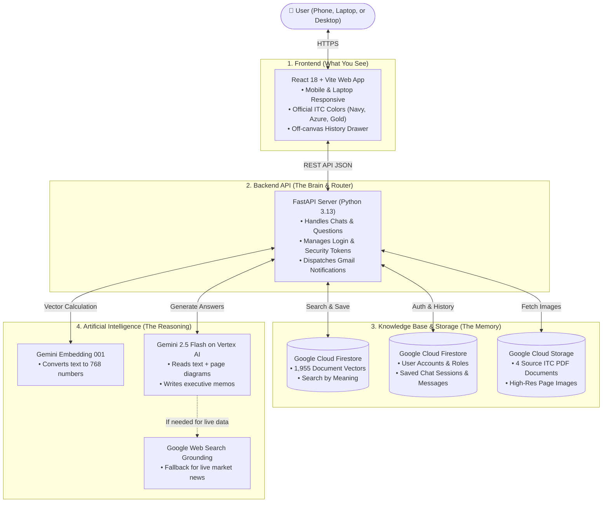
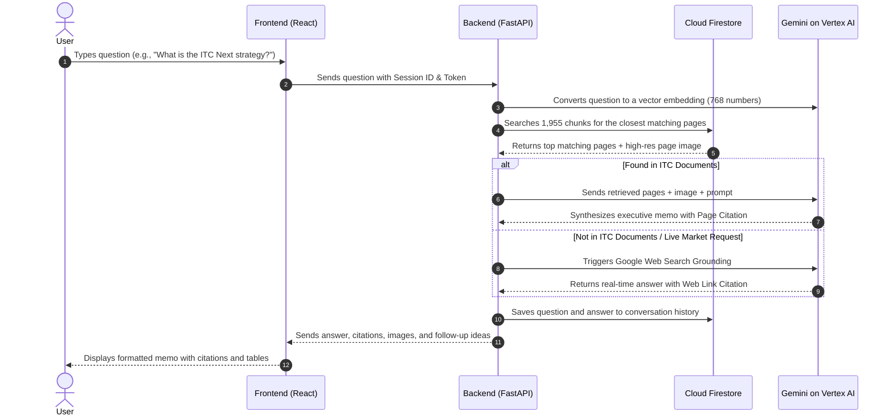

# ITC Insight — Complete Project Architecture & Features Guide

> **Welcome!** This document explains what **ITC Insight** is, how it works under the hood (its architecture), and all the features it offers. It is written in simple, clear English so that anyone—whether you are a student, developer, executive, or business manager—can easily understand it.

---

## 1. What is ITC Insight?

Imagine you have a giant stack of company reports, presentations, and balance sheets from **ITC Limited** that are more than **600 pages** long. Finding a specific number, strategic plan, or financial chart inside them can take hours.

**ITC Insight** is an intelligent AI-powered research assistant built specifically for ITC Limited. 
- You can ask it any question about ITC in normal English (like *"What is the ITC Next strategy?"* or *"What are ITC's top foods brands?"*).
- In a few seconds, it reads the exact pages, understands both the text and the charts, and gives you a clear, professional answer.
- Best of all, it **never guesses or invents numbers**. It gives you the exact document name, page number, and even shows you the actual image of the page!

---

## 2. The Big Picture: How the System is Built (Architecture)

The project is built like a modern, 4-tier system:

---

## 3. The 4 Main Parts Explained Simply

### Part 1: The Frontend (The User Interface)
- **Technology**: React 18, Vite, Modern CSS.
- **What it does**: This is the website you interact with on your screen.
- **Design**: Styled with ITC Limited's official corporate identity (Royal Navy Blue, Luminous Azure, and Warm Gold).
- **Universal Responsiveness**: It automatically adapts whether you are on an iPhone, Android, iPad, small 14-inch laptop, or giant 4K monitor.

### Part 2: The Backend Server (The Coordinator)
- **Technology**: Python 3.13 and FastAPI.
- **What it does**: It receives questions from the user, controls who is allowed to log in, queries the database, talks to Google Gemini AI, and sends back the final answer.
- **Security**: It uses Google Application Default Credentials (ADC) without saving any sensitive password files or secret keys in the code.

### Part 3: The Google Cloud Database (Firestore & Storage)
- **Technology**: Google Cloud Firestore & Google Cloud Storage.
- **What it does**:
  1. **Knowledge Store**: Stores 1,955 pieces of ITC reports as 768-dimensional mathematical "vectors" (meaning-based search).
  2. **User Database**: Stores registered users, account approvals, and passwords safely hashed with `bcrypt`.
  3. **Chat History**: Automatically saves your conversations so you can revisit them anytime.
  4. **Document Storage**: Keeps the original PDFs and high-resolution images of each page.

### Part 4: Google Gemini AI (Vertex AI)
- **Technology**: `gemini-2.5-flash` and `gemini-embedding-001`.
- **What it does**:
  - Converts questions into mathematical vectors to find the most relevant report pages.
  - Reads both the text AND images/diagrams from those pages.
  - Writes a concise, accurate executive briefing in clear English with bullet points and financial tables.

---

## 4. What Happens When You Ask a Question? (Step-by-Step)

Here is the exact journey of a question from the moment you click **"Inquire"**:

1. **You ask**: You type a question into the search bar.
2. **Translate to Meaning**: The backend turns your question into a mathematical vector that represents its *meaning* (not just matching words).
3. **Database Search**: It searches the 1,955 chunks in Firestore to find the top 5 most relevant pages from ITC's reports.
4. **Multimodal Reading**: If the page has a strategy diagram (like the *ITC Next growth pillars*), Gemini looks at both the text and the picture.
5. **Answer Generation**: Gemini writes a structured answer in its own words, complete with headings, bullet points, and data tables.
6. **Provenance Attached**: It attaches exact citations (e.g., `📄 ITC Report and Accounts 2026, Page 13`).
7. **Web Fallback (Only if needed)**: If you ask something not in the documents (like today's live stock price), it securely checks Google Web Search and marks it clearly as `🌐 Web Source`.
8. **Saved for Later**: The whole conversation is automatically saved to your history drawer in Firestore.

---

## 5. Key Features of the Project

### 1. Multimodal Document Understanding (Reads Text + Charts)
Most AI chatbots only read plain text and ignore diagrams, organizational charts, and financial tables.
- ITC Insight extracts high-resolution page pictures (150 DPI).
- It can read complex strategic frameworks, growth pillars, and financial schedules.
- You can click on any citation to open a **Resource Inspector Modal** that shows you the actual source page.

### 2. Strict Verification & Zero Hallucination
- Every single fact is backed by a verifiable source.
- Citations show the exact report name and page number.
- The assistant is instructed to never fabricate numbers. If information is missing from the reports, it honestly says so or searches the web with a clear badge.

### 3. User Accounts with Admin Approval Gate & Email Notifications
To keep enterprise intelligence safe:
1. **User Sign-up**: A new user registers with their name, email, and password.
2. **Approval Gate**: Their account is placed in `pending` status and cannot log in yet.
3. **Instant Email Alert**: The system automatically sends an email to the Administrator (`hrishikeshdeshpande23@gmail.com`) stating that a new user is requesting access.
4. **Administrator Portal**: The admin logs into the built-in **Administrator Governance Console** (`🛡️ Admin Portal`) to view pending requests, statistics, and click **Approve** or **Reject**.
5. **Welcome Email**: Once approved, an automated welcome email is sent to the user notifying them that their account is ready.

### 4. Cloud Conversation History
- Each inquiry starts a persistent session.
- You can create a **+ New Inquiry** anytime.
- All previous conversations are listed in the left sidebar drawer with timestamps and message counts.
- You can switch between conversations or delete old ones with one tap.

### 5. Universal Responsive Design (Desktop, Laptop & Mobile)
- **Large Desktops**: Beautiful multi-column layout with fixed sidebar.
- **Small Laptops (1366x768 / 1080p scaled)**: Height-aware design where all content fits inside the screen without awkward vertical scrolling.
- **Mobile Phones & Tablets**:
  - Slide-out off-canvas drawer with a darkened translucent backdrop.
  - Single-row compact header with clean icons and user initials avatar (`HD`).
  - Font size set to 16px to prevent iOS Safari from zooming into input fields.
  - Horizontal swipeable suggestion chips and mobile-padded data tables.
  - Safe-area padding for iPhone and Android home gesture bars.

### 6. Smooth Sign-Out Protection
- Tapping **Sign Out** doesn't abruptly kick you out.
- It opens an executive confirmation dialog: *"Are you sure you want to sign out?"* showing your name, email, and account status.
- Once confirmed, it smoothly animates out and clears your session credentials.

### 7. Google Cloud Run Deployment ($0.00 Idle Cost)
- The entire project (frontend + backend + AI engine) is packaged in a lightweight Docker container.
- Deployed on **Google Cloud Run** in region `us-east1`.
- Configured with **0 minimum instances**: when nobody is using the site, the servers sleep, costing **$0.00 per hour**. When a user visits, it wakes up automatically in seconds.

---

## 6. The 4 Official ITC Documents in the System

| Document Filename | Length | Topics Covered |
| :--- | :--- | :--- |
| `cmd-presentation.pdf` | 75 pages | FMCG Transformation, new product launches, distribution reach, digital initiatives. |
| `ITC-R-and-A-2026-Theme-feature.pdf` | 24 pages | *ITC Next* corporate strategy, multi-capital value creation architecture. |
| `ITC-Report-and-Accounts-2026.pdf` | 404 pages | Full Annual Report, Board governance, financial schedules, segmental performance. |
| `itc-sustainability-report-2025.pdf` | 140 pages | *Sustainability 2.0*, Carbon positive, Water positive, Solid waste recycling, ESG goals. |

**Total Knowledge Base**: **643 pages** converted into **1,955 searchable chunks** with visual context.

---

## 7. Technology Stack at a Glance

| Component | Technology Used | Why It Was Chosen |
| :--- | :--- | :--- |
| **Frontend UI** | React 18, Vite | Fast, responsive, modern user experience. |
| **Backend API** | Python 3.13, FastAPI | High-speed asynchronous Python web framework. |
| **Generative AI** | Gemini 2.5 Flash (Vertex AI) | Ultra-fast multimodal reasoning with text and images. |
| **Embeddings** | Gemini Embedding 001 | 768-dimensional high-accuracy semantic search. |
| **Cloud Database** | Google Cloud Firestore | Serverless, real-time NoSQL database with native vector search. |
| **File Storage** | Google Cloud Storage (GCS) | Secure cloud bucket for PDF reports and page renders. |
| **Email Service** | SMTP with Google App Password | Instant zero-cost email alerts for user account approval. |
| **Deployment** | Google Cloud Run (Docker) | Fully managed serverless container with $0.00 idle cost. |

---

## 8. Simple Glossary of Terms

- **RAG (Retrieval-Augmented Generation)**: A technique where the AI first searches for real facts in your documents before writing an answer, preventing it from making things up.
- **Embedding**: Converting words or sentences into a list of numbers that capture their meaning.
- **Vector Search**: Searching for information by *meaning* rather than exact keyword matches (e.g., searching for *"financial gains"* will find pages talking about *"revenue growth"*).
- **Multimodal AI**: An AI that can understand more than just text—it can also "see" pictures, charts, and diagrams.
- **Firestore**: Google's modern cloud database that saves data instantly across the globe.
- **Cloud Run**: Google's hosting platform that runs web apps inside containers and only charges when requests arrive.
- **ADC (Application Default Credentials)**: A secure Google Cloud method that lets code authenticate automatically without storing risky password files in the code.

---

*Document prepared for ITC Insight Platform • Built with Google Vertex AI & Cloud Run*

