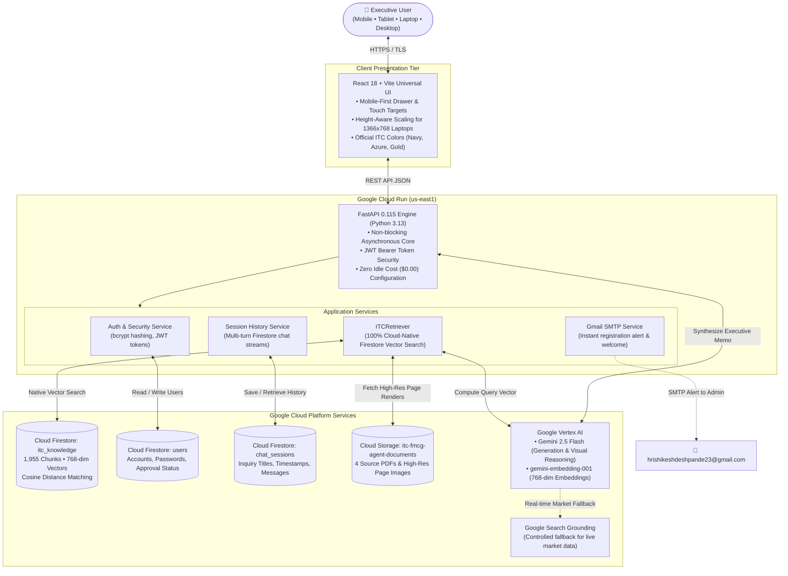

# ITC INSIGHT
### Enterprise Market Intelligence • Strategy • Governance • ESG

> *"Understand ITC. Discover the insight behind the data."*

**Live Production Deployment**: [https://itc-insight-agent-51798849451.us-east1.run.app](https://itc-insight-agent-51798849451.us-east1.run.app)

---

## 1. Executive Summary & Overview

**ITC Insight** is an enterprise-grade, **100% Cloud-Native Multimodal Retrieval-Augmented Generation (RAG)** platform designed specifically for **ITC Limited**. Purpose-built for corporate strategy directors, financial analysts, institutional investors, and governance auditors, it provides high-precision synthesis across ITC's diverse conglomerate businesses:

- **FMCG Businesses**: Branded Packaged Foods, Personal Care, Education & Stationery Products, Incense Sticks (*Agarbattis*) & Safety Matches.
- **Corporate Strategy (*ITC Next*)**: Digital ecosystem scaling, direct-to-consumer platforms, multi-capital value creation, and supply chain fortification.
- **Corporate Governance**: Board leadership structure, committee oversight, compliance, and enterprise risk management.
- **Sustainability & ESG Leadership**: Water positive (22+ consecutive years), carbon positive (18+ consecutive years), solid waste recycling positive, and renewable energy adoption.

Unlike standard document chat tools that discard layout structures and hallucinate metrics, ITC Insight features a **page-aware, multimodal architecture** backed by **Google Cloud Firestore Vector Search**, **Gemini 2.5 Flash on Vertex AI**, strict source provenance, and an **Administrative Governance Approval Gate**.

---

## 2. Current Cloud-Native Architecture



---

## 3. Key Platform Capabilities & Engineering Features

### 1. 100% Cloud-Native Firestore Vector Search
- **No Local Index Files in Production**: The vector store runs entirely inside **Google Cloud Firestore** under the `itc_knowledge` collection.
- **768-Dimensional Embeddings**: Generated using Google's `gemini-embedding-001` with task-type optimization (`RETRIEVAL_DOCUMENT` during ingestion and `RETRIEVAL_QUERY` during inference).
- **Native Cosine Distance Retrieval**: Utilizes Firestore's native vector index querying (`find_nearest` with COSINE distance) to retrieve the top $K$ relevant chunks in under 300ms.

### 2. Multimodal Page & Visual Understanding
- **Diagram Comprehension**: High-resolution (150 DPI) images are extracted for every PDF page containing diagrams (e.g., *ITC Next strategic framework pillars*, *value creation flows*, *sustainability targets*).
- **Multimodal LLM Reasoning**: `gemini-2.5-flash` analyzes both the extracted text and the page image simultaneously, allowing the AI to describe organizational charts, matrices, and process diagrams accurately.
- **Interactive Resource Inspector**: Every citation includes a clickable preview that opens a full-screen high-resolution view of the exact source document page.

### 3. Strict Provenance & Zero Hallucination
- **Document-First Retrieval**: Answers are synthesized exclusively from verified evidence in ITC's filings.
- **Page-Level Citations**: Every response lists precise citations (e.g., `📄 ITC Report and Accounts 2026, Page 13`).
- **Controlled Web Grounding**: If a user asks for real-time market data not in the annual reports (e.g., *"current stock price"* or *"recent press releases"*), the engine falls back to Google Search Grounding through Vertex AI and flags the citation with `🌐 Web Source`.
- **Refusal Handling**: If the answer cannot be verified in the documents or via search, the assistant explicitly states that reliable data is unavailable.

### 4. Enterprise Authentication & Admin Governance Approval Loop
- **Security Gating**: Guest users cannot query the engine or access corporate briefings.
- **Registration Approval Workflow**:
  1. A new user registers with their corporate email, display name, and password.
  2. The account is created with `status: pending`.
  3. **Real-Time Email Notification**: The system dispatches an automated email to the Administrator (`hrishikeshdeshpande23@gmail.com`) alerting them of the access request.
  4. **Admin Governance Console**: The admin logs into the dedicated `🛡️ Admin Portal` within the web application to view pending requests, inspect user accounts, and click **Approve** or **Reject**.
  5. **Automated Welcome Email**: Upon approval, a welcome confirmation email is automatically sent to the approved user.

### 5. Persistent Cloud History & Multi-Turn Conversations
- **Firestore-Backed Sessions**: Every conversation is saved under `chat_sessions` and `chat_messages` in Firestore.
- **Contextual Follow-ups**: The engine remembers previous dialogue turns within the active session.
- **Session Management**: Users can switch between prior inquiries, start new ones, or delete sessions directly from the history drawer.

### 6. Universal Responsive Design (Desktop, Laptop & Mobile)
- **Fluid Layout**: Uses dynamic `clamp()` typography and spacing across all devices.
- **Height-Aware Laptop Optimization**: Employs `@media (max-height: 850px)` and `@media (max-height: 720px)` queries so that on standard 14-inch laptops (1366x768 and 1080p with Windows display scaling), the hero banner, search bar, and suggested questions fit 100% inside the viewport without vertical scrolling.
- **Mobile & Tablet Drawer System**:
  - Off-canvas slide-out history drawer (`width: min(85vw, 310px)`) with smooth `transform: translateX` animation.
  - Translucent dark backdrop overlay (`sidebar-mobile-backdrop`) that closes the drawer on tap.
  - Selecting any previous session or clicking "+ New Inquiry" automatically collapses the drawer.
  - Touch targets $\ge 44\text{px}$ and `16px` input font size to eliminate iOS Safari auto-zooming.
  - Safe-area insets (`env(safe-area-inset-bottom)`) for iPhone and Android navigation gesture bars.

### 7. Smooth Signout Confirmation
- Prevents accidental logouts with an executive modal dialog detailing current user profile, email, and session safety.
- Graceful animated exit transition that smoothly clears client-side JWT tokens and application state.

### 8. Production Cloud Run Architecture ($0.00 Idle Cost)
- **Containerized Deployment**: Single unified Docker container running Uvicorn and serving optimized Vite static bundles.
- **Zero Minimum Instances**: Configured with `--min-instances 0`, scaling to zero when idle for **$0.00/hour idle infrastructure cost**.
- **Instant Cold Start**: Scales up automatically upon incoming HTTP traffic.

---

## 4. Knowledge Base Scope (Official ITC Filings)

| # | Document Name | Filename | Pages | Focus Areas |
| :-: | :--- | :--- | :-: | :--- |
| **1** | **Chairman & Managing Director Presentation** | `cmd-presentation.pdf` | 75 | FMCG Transformation, new platforms, brand scaling, distribution reach, digital initiatives. |
| **2** | **ITC Report & Accounts 2026: Theme Feature** | `ITC-R-and-A-2026-Theme-feature.pdf` | 24 | *ITC Next* corporate strategy, multi-capital value creation architecture. |
| **3** | **ITC Annual Report & Accounts 2026** | `ITC-Report-and-Accounts-2026.pdf` | 404 | Complete Financial Statements, Governance, Risk Frameworks, Board Committees, Schedules. |
| **4** | **ITC Sustainability Report 2025** | `itc-sustainability-report-2025.pdf` | 140 | *Sustainability 2.0*, Carbon/Water positive metrics, solid waste recycling, climate resilience. |

**Total Ingestion**: **643 pages** processed into **1,955 enriched chunks** with table structures, visual diagrams, and 768-dimensional embeddings stored in Google Cloud Firestore.

---

## 5. Technology Stack

| Layer | Component | Specification |
| :--- | :--- | :--- |
| **Frontend** | Framework | React 18, Vite 6, Modern CSS Variables |
| | Visual Theme | Official ITC Palette: Navy (`#062F62`), Azure (`#257CE0`), Gold (`#D4AF37`) |
| | Responsiveness | Universal viewport support (Mobile 320px–480px, Tablet 768px, Laptop 1366px, Desktop 1080p+) |
| **Backend** | Runtime & API | Python 3.13, FastAPI 0.115, Uvicorn, Pydantic V2 |
| | Authentication | JWT Bearer Tokens, Passlib (`bcrypt`), Role-Based Access Control (`user`, `admin`) |
| | Email Engine | SMTP Client with Google App Password Integration |
| **AI & RAG** | Vector Store | Google Cloud Firestore (Native 768-dim Vector Search with Cosine Distance) |
| | Embeddings | `gemini-embedding-001` via Vertex AI (768 dimensions) |
| | Generative Model | `gemini-2.5-flash` via Google Vertex AI (`us-east1`) |
| | Fallback Search | Google Web Search Grounding via Vertex AI |
| | Multimodal Engine | PyMuPDF (`fitz`), Pillow, Gemini Vision API |
| **Cloud Infra** | Compute | Google Cloud Run (Containerized, auto-scaling 0 to 1 instance) |
| | Object Storage | Google Cloud Storage (`gs://itc-fmcg-agent-documents`) |
| | IAM & Security | Dedicated Service Account (`itc-fmcg-agent-sa@...`), Zero JSON Key Policy |

---

## 6. Local Setup & Development Guide

### Prerequisites
- Windows 10/11 with PowerShell (or macOS / Linux)
- Python 3.10+ (Tested on Python 3.13)
- Node.js 18+ (Tested on Node 20+)
- Google Cloud CLI (`gcloud`) authenticated via Application Default Credentials (`gcloud auth application-default login`)

### Step 1: Clone Repository
```powershell
cd "C:\Users\Hrishikesh Deshpande\OneDrive\Desktop\FMCG_ITC_AGENT"
```

### Step 2: Configure Environment Variables
Copy the environment template:
```powershell
Copy-Item backend\.env.example backend\.env
```
Ensure `backend/.env` contains the required configuration:
```ini
GOOGLE_CLOUD_PROJECT=itc-fmcg-agent
GOOGLE_CLOUD_LOCATION=us-east1
GOOGLE_GENAI_USE_VERTEXAI=true

GCS_BUCKET=itc-fmcg-agent-documents
GCS_SOURCE_PREFIX=itc/source-documents/

EMBEDDING_MODEL=gemini-embedding-001
EMBEDDING_DIMENSION=768
GENERATION_MODEL=gemini-2.5-flash
FIRESTORE_KNOWLEDGE_COLLECTION=itc_knowledge

ADMIN_EMAIL=hrishikeshdeshpande23@gmail.com
APP_URL=https://itc-insight-agent-51798849451.us-east1.run.app
SMTP_HOST=smtp.gmail.com
SMTP_PORT=587
SMTP_USER=hrishikeshdeshpande23@gmail.com
SMTP_PASSWORD=your-google-app-password
```

### Step 3: Install Backend Dependencies
```powershell
python -m pip install -r backend\requirements.txt
```

### Step 4: Run Knowledge Ingestion (or Sync to Firestore)
If you wish to re-sync or inspect the Firestore knowledge collection:
```powershell
# Sync vector store to Google Cloud Firestore 'itc_knowledge'
python -m app.scripts.sync_to_firestore

# Inspect embeddings directly in Firestore
python -m app.scripts.inspect_firestore_embeddings
```

### Step 5: Run the Backend Server
```powershell
cd backend
python -m uvicorn app.main:app --host 0.0.0.0 --port 8000 --reload
```
- API Docs (Swagger UI): `http://127.0.0.1:8000/docs`
- Health Endpoint: `http://127.0.0.1:8000/health`

### Step 6: Run the Frontend Development Server
In a separate terminal:
```powershell
cd frontend
npm install
npm run dev
```
- Open `http://localhost:5173` in your browser.

---

## 7. Cloud Run Production Deployment

The project includes an optimized single-step deployment to Google Cloud Run using Docker:

```powershell
# 1. Build the production React frontend bundle
cd frontend
npm run build
cd ..

# 2. Deploy to Cloud Run with minimum cost architecture (0 min-instances)
$env:CLOUDSDK_METRICS_ENVIRONMENT="datacloud.antigravity"
gcloud run deploy itc-insight-agent `
  --source . `
  --region us-east1 `
  --service-account itc-fmcg-agent-sa@itc-fmcg-agent.iam.gserviceaccount.com `
  --env-vars-file cloudrun_env.yaml `
  --allow-unauthenticated `
  --min-instances 0 `
  --max-instances 1 `
  --cpu 1 `
  --memory 1Gi `
  --concurrency 80 `
  --timeout 300 `
  --quiet
```

**Production Endpoint**: [https://itc-insight-agent-51798849451.us-east1.run.app](https://itc-insight-agent-51798849451.us-east1.run.app)

---

## 8. Verification & Test Suite

The codebase includes comprehensive automated test suites:

### 1. Component Unit Tests
Verifies document loaders, chunking logic, table extractors, embedding generation, Firestore adapters, and FastAPI routes:
```powershell
python -m pytest backend/tests/test_all_components.py -v
```

### 2. Firestore Authentication & Governance Tests
Validates user registration, password hashing, approval gates, admin role enforcement, and token issuance:
```powershell
python -m pytest backend/tests/test_firestore_auth.py -v
```

### 3. End-to-End Enterprise Query Benchmark
Executes 9 real-world strategic inquiries spanning *ITC Next*, FMCG Brand Portfolios, Value Creation Models, Corporate Governance, and Sustainability:
```powershell
python backend/tests/test_end_to_end_queries.py
```

---

## 9. Security, Governance & Compliance

1. **Zero JSON Key Architecture**: No service account `.json` keys or credential secrets exist anywhere in the source code or client bundles. Authentication relies solely on Google Cloud Application Default Credentials (ADC) and IAM service accounts.
2. **Password Cryptography**: All passwords are irreversibly hashed using `bcrypt` (12 rounds) before storage in Firestore.
3. **Session Integrity**: Client authentication uses signed JWT tokens with configurable expiration and automatic revocation upon logout.
4. **Data Isolation**: User inquiries and session histories are partitioned by `user_id` inside Firestore, ensuring strict tenancy boundaries between executives.

---

*ITC Insight Platform • Built for ITC Limited Executive Intelligence • Powered by Google Cloud & Vertex AI*
